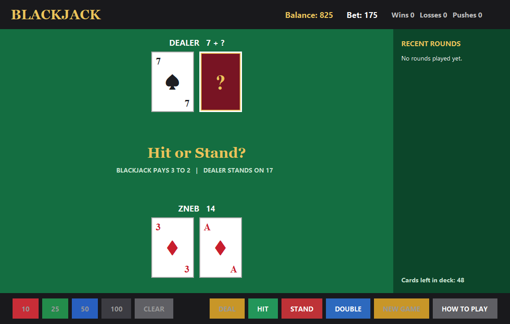
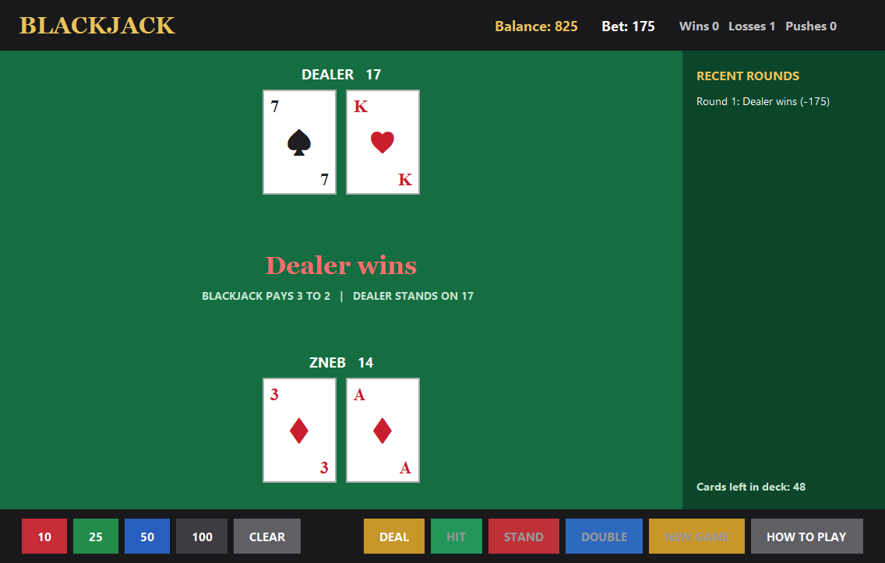
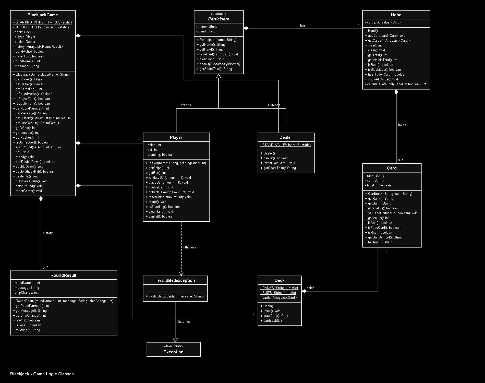
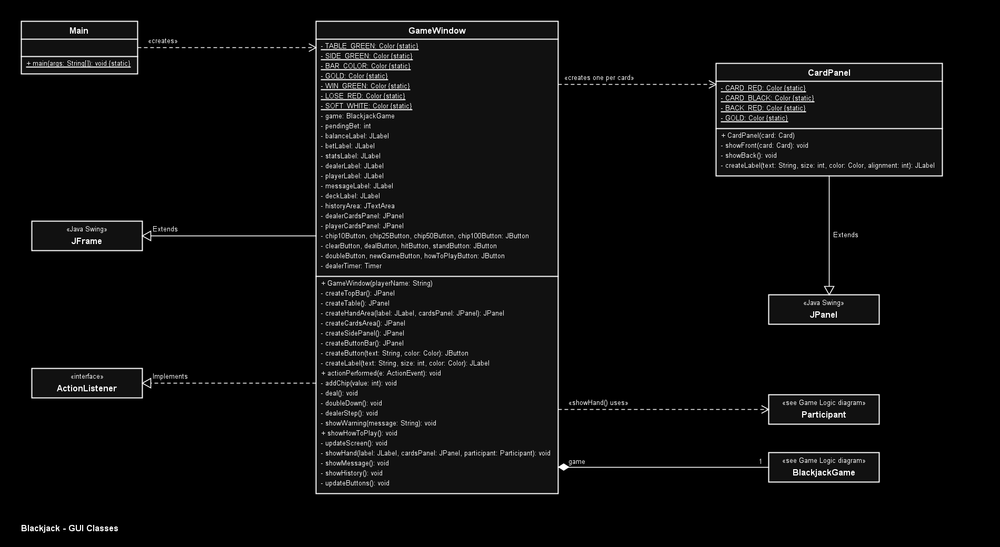

# Blackjack

A casino-style **Blackjack** card game written in **Java** with a **Swing GUI**. One player plays against a computer dealer, following real casino rules.

| | |
|---|---|
| **Subject** | CIT 240 - Object Oriented Programming (OOP) |
| **Section** | BSCS 2A |
| **Project** | Midterm Group Project |
| **Topic** | Card or Board Game: players, rules, turns |
| **Language** | Java (Swing for the GUI) |



## Table of Contents
1. [Team Members](#team-members)
2. [Project Overview](#project-overview)
3. [Features](#features)
4. [Screenshots](#screenshots)
5. [Requirements](#requirements)
6. [How to Run](#how-to-run)
7. [How to Play (User Manual)](#how-to-play-user-manual)
8. [Project Structure](#project-structure)
9. [OOP Design](#oop-design)
10. [Testing](#testing)
11. [Limitations and Future Improvements](#limitations-and-future-improvements)

## Team Members

| Name |
|---|
| Zneb Delariman |
| Nico Campania |
| French Mar Ballescas |

## Project Overview

**Problem:** Blackjack is a card game with clear rules about players, turns and winning. That makes it a good fit for showing object-oriented design: every part of the game (cards, deck, hands, player, dealer) becomes its own class.

**Target users:** Anyone who wants to play or learn Blackjack on their computer, and students learning how OOP is used in a real program.

**Objectives:**
- Build a complete, playable Blackjack game with a graphical user interface.
- Apply the four pillars of OOP: encapsulation, inheritance, polymorphism and abstraction.
- Enforce the betting rules with a custom exception.
- Keep the game rules separate from the GUI so the rules can be tested on their own.

**Scope:**
- One human player against one computer dealer, using two shuffled 52-card decks.
- Betting with chips, Hit, Stand, Double Down, Split, Blackjack payouts, and a round history.
- All data is kept in memory while the program runs. Nothing is saved to files or a database.

## Features

- Graphical casino table built with Java Swing.
- Chip buttons (10, 25, 50, 100) to build a bet, with a Clear button.
- **Hit**, **Stand** and **Double Down** actions. Buttons turn on and off depending on what is allowed.
- **Split** when the first two cards have the same rank. Each split hand has its own equal bet and turn.
- The dealer's second card stays face down until the player's turn is over.
- The dealer draws one card at a time so the player can follow along.
- Correct Ace handling (counts as 1 or 11 automatically).
- Blackjack pays 3 to 2, and a push returns the bet.
- Live balance, current bet, and win/loss/push counts.
- Recent Rounds panel showing the result of each round.
- Built-in **How to Play** guide, shown when the game starts.
- Clear warning messages when a bet breaks the rules.
- **New Game** option when the player runs out of chips.

## Screenshots

| Player's turn | Round result |
|---|---|
|  |  |

## Requirements

| Requirement | Details |
|---|---|
| Java | JDK 8 or newer (developed and tested with JDK 26) |
| Libraries | None. Swing is included with Java. |
| Editor (any one) | jGRASP, VS Code with the Extension Pack for Java, or the command line |
| Operating system | Any system that runs Java (developed on Windows 11) |

## How to Run

### 1. Get the project
Download it with Git:
```
git clone https://github.com/zneb21/OOP_Finals.git
```
Or, on GitHub, click **Code > Download ZIP** and extract it.

All Java files are in the `src` folder. They use no packages, so they can be compiled and run straight from that folder.

### 2a. Run in jGRASP
1. Open jGRASP and open `src/Main.java`.
2. Click **Build > Compile All** (or the green **Compile** button). jGRASP compiles the other classes in the folder as well.
3. Click **Run** (the red running figure).
4. Type your name in the popup and press **OK**. The game window opens with the How to Play guide.

### 2b. Run in VS Code
1. Install the **Extension Pack for Java** (by Microsoft).
2. Click **File > Open Folder** and open the `OOP_Finals` folder.
3. Open `src/Main.java` and click **Run** above the `main` method (or press **F5**).

### 2c. Run from the command line
```
cd OOP_Finals/src
javac *.java
java Main
```

### Running the test cases
The rules can be tested without opening the window:
- **jGRASP / VS Code:** open `src/TestCases.java` and click **Run**.
- **Command line:** after compiling, run `java TestCases`.

The results are printed in the console as `[PASS]` or `[FAIL]` for each test.

### Troubleshooting
| Problem | Solution |
|---|---|
| `javac` is not recognized | Install a JDK and make sure it is added to your system PATH. |
| Old buttons or text still appear | Compile all files again so the old `.class` files are replaced. |
| The window does not open in VS Code | Make sure you opened the whole `OOP_Finals` folder, not just one file. |

## How to Play (User Manual)

When the game starts, it asks for your name, then shows the **How to Play** guide. You can open the guide again at any time with the **HOW TO PLAY** button.


### Goal
Get a hand closer to **21** than the dealer, without going over 21. You start with **1,000 chips**.

### Card values
| Card | Value |
|---|---|
| 2 to 10 | Its number |
| J, Q, K | 10 |
| Ace | 11, or 1 if 11 would make you go over 21 |

### Step 1: Place your bet
Click the chip buttons (**10**, **25**, **50**, **100**) to add to your bet. You can click them more than once, for example 100 + 50 + 25 = 175. Click **CLEAR** to start your bet over. You cannot bet more chips than you have.

### Step 2: Deal
Click **DEAL**. You and the dealer each get 2 cards. One of the dealer's cards is face down (shown as **?**), so you only see part of the dealer's total, for example `10 + ?`.

### Step 3: Your turn
| Button | What it does |
|---|---|
| **HIT** | Take another card. You can hit as many times as you want. |
| **STAND** | Keep your cards and end your turn. |
| **DOUBLE** | Double your bet, take exactly 1 more card, then stand. Only allowed with your first 2 cards. |
| **SPLIT** | If your first two cards have the same rank, create two hands with equal bets and play them one at a time. |

If your total goes over 21, you **bust** and lose your bet right away.

### Step 4: Dealer's turn
The dealer shows the hidden card, then must keep taking cards until the total is **17 or more**. The dealer does not make choices; it always follows this rule.

### Step 5: Results
| Result | What you get |
|---|---|
| **Win** (higher total, or the dealer busts) | Your bet back plus the same amount |
| **Blackjack** (21 with your first 2 cards) | Your bet back plus 1.5 times your bet |
| **Push** (same total as the dealer) | Your bet back |
| **Lose** (lower total, or you bust) | Nothing, the dealer keeps your bet |

The result appears in the middle of the table (green for a win, red for a loss) and is added to **Recent Rounds** on the right. The top bar shows your balance, your current bet, and your wins, losses and pushes.

### Next round
Your bet stays the same for the next round, so you can just click **DEAL** again, or change it with the chips and **CLEAR**. If you run out of chips, click **NEW GAME** to start over with 1,000 chips.

### Example round
1. You click **100** and **50**. Your bet is 150.
2. You click **DEAL**. You get 9 and 7 (total 16). The dealer shows a 10 and a hidden card.
3. You click **HIT** and get a 4. Your total is now 20.
4. You click **STAND**. The dealer reveals a 7 (total 17) and must stop.
5. 20 beats 17, so you win 150 chips. Your balance goes from 1,000 to 1,150.

## Project Structure

```
OOP_Finals/
|-- README.md
|-- docs/
|   |-- UML_Game_Logic.png      UML class diagram of the game rules
|   |-- UML_GUI.png             UML class diagram of the window
|   +-- screenshots/            Pictures of the game
+-- src/
    |-- Main.java               Starting point of the program
    |-- GameWindow.java         Main window and buttons
    |-- CardPanel.java          One card on the screen
    |-- BlackjackGame.java      Game rules and turns
    |-- Participant.java        Abstract parent of Player and Dealer
    |-- Player.java             The human player
    |-- Dealer.java             The computer dealer
    |-- Hand.java               Cards held by a participant
    |-- Deck.java               Two shuffled 52-card packs
    |-- Card.java               One playing card
    |-- RoundResult.java        Result of one round
    |-- InvalidBetException.java   Custom exception for bets
    +-- TestCases.java          Console test cases
```

| File | Purpose |
|---|---|
| `Card.java` | One playing card (rank, suit, face up or down) |
| `Deck.java` | Two 52-card packs (104 cards), shuffle and draw |
| `Hand.java` | Cards held by a participant, and the total (Aces count as 1 or 11) |
| `Participant.java` | **Abstract** parent of Player and Dealer |
| `Player.java` | The human player: chips, bet, betting rules |
| `Dealer.java` | The house: hits on 16 or less, stands on 17 |
| `InvalidBetException.java` | **Custom exception** for the betting rules |
| `RoundResult.java` | The record of one finished round |
| `BlackjackGame.java` | Game rules and turns (no GUI code) |
| `Main.java` | Program entry point: asks for your name and opens the window |
| `GameWindow.java` | The main window: table, labels, buttons, and what happens when you click them |
| `CardPanel.java` | Shows one card on screen (white card with rank and suit, or a red back when face down) |
| `TestCases.java` | Console test cases for the rules |

The game rules (`BlackjackGame` and the classes it uses) contain no GUI code. The GUI (`GameWindow` and `CardPanel`) only reads the game's state and calls its methods. This keeps the rules easy to test and the screen code easy to change.

## OOP Design

### UML class diagrams
The diagrams match the final source code.

**Game logic classes**



**GUI classes**



### How the project meets the requirements

| Requirement | Where |
|---|---|
| At least 3 meaningful classes | 13 classes (see the table above) |
| Encapsulation | All fields are `private`. Access is through methods, e.g. `Player.placeBet()` is the only way to change chips. `Hand.getCards()` returns a copy so the hand cannot be changed from outside. |
| Inheritance | `Player` and `Dealer` extend `Participant`. `InvalidBetException` extends `Exception`. `GameWindow` extends `JFrame` and `CardPanel` extends `JPanel`. |
| Polymorphism (overriding) | `canHit()` is overridden in `Player` (until stand or 21) and `Dealer` (below 17). `Dealer` overrides `getScoreText()` to hide the face-down card. `Player` overrides `clearHand()` and calls `super.clearHand()`. `GameWindow.showHand()` takes a `Participant`, so the right `getScoreText()` runs for the Player and for the Dealer. |
| Abstraction | `abstract class Participant` with `abstract boolean canHit()`. |
| Interface implementation | `GameWindow implements ActionListener` and overrides `actionPerformed()` to handle every button click. |
| Custom exception | `InvalidBetException` is thrown by `Player.validateBet()`, `placeBet()` and `doubleBet()` when a bet is 0, more than the chips, or a double down cannot be afforded. `GameWindow` catches it and shows the message in a popup. |
| Collections | `ArrayList<Card>` in `Deck` and `Hand`, `ArrayList<RoundResult>` for the round history. |
| Data storage | In memory only. Nothing is saved to files or a database. |
| User interface | Swing GUI (bonus). |

## Testing

Run `TestCases.java` to check the game rules. Current result: **14 passed, 0 failed**.

| # | Test | Expected |
|---|---|---|
| 1 | Ace + King is Blackjack | true |
| 2 | Ace + Ace + 9 totals 21 | 21 |
| 3 | King + Queen + 5 is a bust | true |
| 4 | Dealer hits on 16 | true |
| 5 | Dealer stands on 17 | false |
| 6 | Dealer score hides the hole card | `10 + ?` |
| 7 | Bet of 0 is rejected | InvalidBetException |
| 8 | Bet over the chips is rejected | InvalidBetException |
| 9 | Valid bet of 60 is accepted | OK |
| 10 | Chips after betting 60 from 100 | 40 |
| 11 | Double down without enough chips | InvalidBetException |
| 12 | Each side gets 2 cards on the deal | 2 and 2 |
| 13 | One round is saved in the history | 1 |
| 14 | Fresh shoe contains two decks | 104 cards |

## Limitations and Future Improvements

**Current limitations**
- Only one player can play against the dealer.
- Insurance is not included.
- Chips and history reset when the program is closed (in-memory only, as required).

**Possible improvements**
- Add Insurance.
- Support more than one player at the table.
- Add card images and sound effects.

---

Academic project for CIT 240 - Object Oriented Programming, BSCS 2A.
